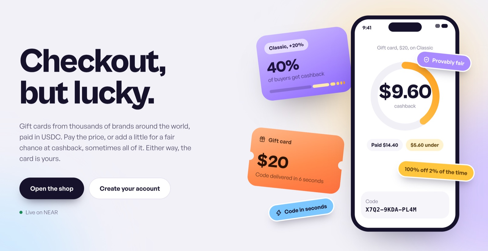
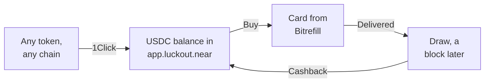
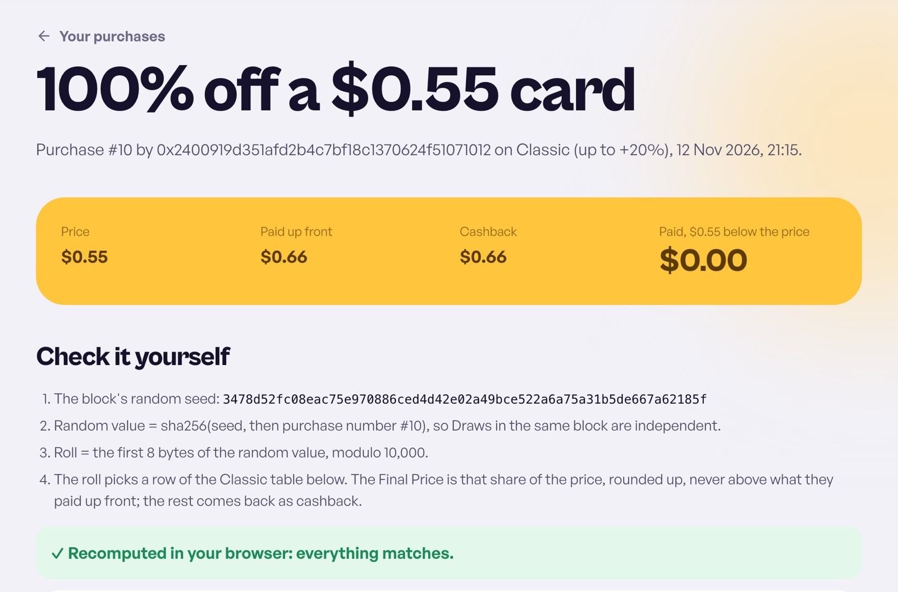
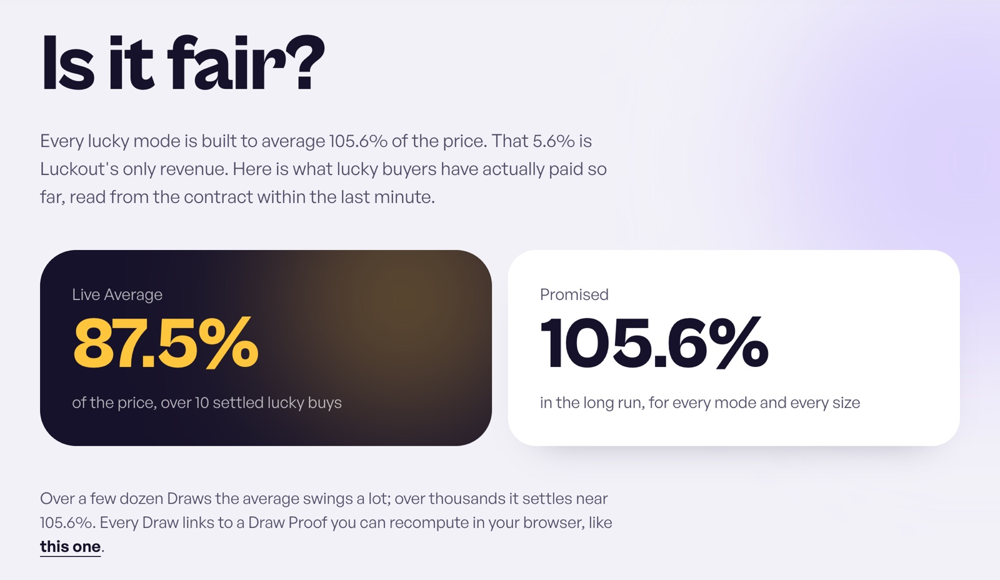

<div align="center">


# Luckout

**Checkout, but lucky.**

Buy the gift cards you already buy, paid in USDC from any chain.<br />
Pay the price, or add a little for a provably fair chance at cashback. Either way, the card is yours.

**[Open the app](https://www.luckout.wtf)** · [Telegram bot](https://t.me/luckoutbot) · [Try it free on testnet](https://testnet.luckout.wtf/welcome) · [Is it fair?](https://www.luckout.wtf/fair)

[](https://github.com/hrsh22/luckout/actions/workflows/ci.yml)
[](https://nearblocks.io/address/app.luckout.near)
[](LICENSE)

</div>



<p align="center">
<a href="#luckout-in-30-seconds">In 30 seconds</a> ·
<a href="#how-it-works">How it works</a> ·
<a href="#try-it">Try it</a> ·
<a href="#near-technology">NEAR technology</a> ·
<a href="#how-it-fits-each-track">Tracks</a> ·
<a href="#security">Security</a>
</p>

## Luckout in 30 seconds

- 🎁 **Real gift cards.** Thousands of brands from Bitrefill: Amazon, Steam, Swiggy and more. The code arrives in seconds.
- 🎲 **Pay the price, or play for cashback.** Add 10%, 20% or 50% up front. A Draw a block later gives back nothing, part of the price or all of it. Every mode averages exactly 5.6% over the price. That margin is our only revenue.
- 🔍 **Don't trust us, check.** Our NEAR contract runs the Draw, and every Draw has a public page that recomputes it in your browser.
- 🌐 **Pay from any chain, no NEAR needed.** Top up with any token through NEAR Intents, sign in with MetaMask if you like, and our relayer pays the gas.
- 🤖 **Or just ask.** A Telegram agent finds and prepares the card; you tap Confirm. Its model runs in a TEE that we verify, and every reply must carry the enclave's signature.

Built during NEAR HACKATHON 2026. See [Hackathon notes](#hackathon-notes).

## Live on NEAR mainnet

| What | Where |
|---|---|
| Web app (real USDC, real gift cards) | [luckout.wtf](https://www.luckout.wtf) |
| Telegram agent | [@luckoutbot](https://t.me/luckoutbot), linked from the web app's Wallet page |
| Contract | [`app.luckout.near`](https://nearblocks.io/address/app.luckout.near), owner `luckout.near` |
| A real Draw Proof (100% cashback), recomputed in your browser | [Purchase #10 on Classic](https://www.luckout.wtf/draw/EYG7gjCYCAzEQMYPj1SrYRWkbLQAsyLEcJ6rqskQyz62) |
| Live Average, reserve, Cashback Cap, code hash, AI enclave check | [luckout.wtf/fair](https://www.luckout.wtf/fair) |
| Free testnet demo (test USDC, Bitrefill test cards) | [testnet.luckout.wtf](https://testnet.luckout.wtf), bot [@luckouttestingbot](https://t.me/luckouttestingbot) |

As of 13 November 2026, mainnet has settled 10 Lucky Buys of real cards, and `app.luckout.near` has 110 transactions. The Cashback Reserve holds $1,000, so one purchase can get up to $200 back. `/fair` reads the current numbers from the contract.

## How it works



1. **Top up from any chain.** NEAR Intents 1Click swaps what you send into native USDC on NEAR, and one deposit moves it into your Luckout balance, which the contract holds. Our relayer pays the NEAR network fee for deposits, withdrawals and settings with NEP-366 meta transactions (ADR-0008), so you never need NEAR.
   - **With an EVM wallet** (MetaMask, Rabby and the like; ADR-0011), you don't need a NEAR account at all. Your USDC lands in your own NEAR Intents account, which your EVM key controls, and an intent you sign moves it into Luckout. Every later step is a message you sign and our relayer sends. The only fee you pay is your own chain's gas for the Top-Up transfer. Withdrawals go back to your address on Base, Ethereum, Arbitrum, Polygon or BNB Chain, gas-free.
2. **Buy** in the web app or ask the Telegram agent. Our server submits the purchase with a key that can only call the contract's purchase methods, so you don't sign every purchase. The contract enforces the Spending Limits you set.
3. **Draw.** When the card is delivered, the contract draws your Cashback a block later and credits it to your balance. The code and the result arrive together, seconds after you buy.
4. **Check it.** Every Draw has a Draw Proof page that recomputes it in your browser from the chain. `/fair` shows the live average against the promised 105.6%.

### The odds

Exact odds on a ₹500 voucher (chance → what you end up paying):

| Cashback | Normal · ₹500 | Lite · ₹550 | Classic · ₹600 | Jackpot · ₹750 |
|---|---:|---:|---:|---:|
| 100% back | — | 1% → ₹0 | 2% → ₹0 | 10% → ₹0 |
| 50% back | — | 1% → ₹275 | 3% → ₹300 | 12% → ₹375 |
| 40% back | — | — | 4% → ₹360 | 34% → ₹450 |
| 30% back | — | 1% → ₹385 | 7% → ₹420 | — |
| 20% back | — | 2% → ₹440 | 24% → ₹480 | — |
| 10% back | — | 18% → ₹495 | — | — |
| No cashback | 100% → ₹500 | 77% → ₹550 | 60% → ₹600 | 44% → ₹750 |
| **Average** | ₹500 | ₹528 | ₹528 | ₹528 |

- Any Cashback leaves you below the normal price.
- Every lucky mode averages exactly 5.6% over the normal price. That margin is our only revenue: no top-up fees, no service fees.
- One purchase can get back at most the Cashback Cap. On mainnet that is 20% of the free Cashback Reserve, and `/fair` shows today's amount. A bigger card still sells: only the part of its price that fits under the cap plays, and the rest is bought at the normal price.



## Try it

### 1. Free, on testnet (about 5 minutes)

1. Open [testnet.luckout.wtf/welcome](https://testnet.luckout.wtf/welcome) and sign in with a testnet NEAR wallet or any EVM wallet. **You see** "How do you like to pay?"
2. Pick a Default Mode (we suggest Classic) and tap Continue. **You see** "Add funds".
3. Tap "Get 100 test USDC". **You see** $100 in your balance, then "You're all set" with your mode and Spending Limits. An EVM wallet needs no testnet funds: the faucet pays its NEAR Intents account, and one signature moves the money in.
4. In the shop, buy the $10 Bitrefill test gift card. **You see** the code, the Draw's result and your new balance within seconds.
5. Open the purchase's Draw Proof. **You see** the seed, the table and the outcome, recomputed in your browser from the testnet transaction.
6. Optional: on the Wallet page, tap "Connect Telegram" and ask the bot for "a $10 test gift card on Jackpot". **You see** one line and a Buy button. Nothing is bought until you tap it.

> [!NOTE]
> Our testnet Bitrefill account allows 15 orders in any 24 hours, shared by everyone trying it. If the shop says Bitrefill refused, try again a few hours later.

### 2. With real money, on mainnet

You need at least $1 of USDC (or another token) on a supported chain, plus that chain's gas.

1. Sign in at [luckout.wtf](https://www.luckout.wtf) with a NEAR wallet or an EVM wallet.
2. Go to Wallet → Add funds, pick a chain and token, and send to the address shown. **You see** the Top-Up move through 1Click (often under a minute from Base), then land in your balance.
3. Buy any card from the shop. The cheapest we've bought is a ₹50 Swiggy voucher, about $0.60. **You see** the real code and, on a lucky mode, the Draw.
4. Withdraw what's left from Wallet → Withdraw. **You see** it go back to your wallet, or to your EVM address on the chain you pick, gas-free.

### 3. Check it without a wallet

- **A Draw Proof:** open the [mainnet Draw Proof](https://www.luckout.wtf/draw/EYG7gjCYCAzEQMYPj1SrYRWkbLQAsyLEcJ6rqskQyz62). It fetches the transaction from NEAR RPC and recomputes the Cashback in your browser.
- **`/fair`:** the Live Average from `get_stats`, the Cashback Reserve and Cashback Cap from `get_reserve`, the contract's code hash, and the latest TEE check of the agent's model.
- **The contract's code:** `cd contract && cargo near build reproducible-wasm` (needs Docker) produces the code hash `/fair` shows.
- **The attack demo:** see [What a stolen server key can do](#what-a-stolen-server-key-can-do).



### 4. Run it locally

<details>
<summary>Install, run the tests, deploy your own contract</summary>

<br />

Needs Node 24+ and pnpm (`corepack enable`).

```sh
pnpm install
cp .env.example .env   # optional; everything below runs without it
pnpm dev               # web on :3000, server on :8787
pnpm test              # unit tests; tests that call Bitrefill or 1Click skip without keys
```

Without any keys, the server starts on PGlite (no database to install), the Draw Proof and Live Average pages read testnet directly, and the shop says which key is missing. With `BITREFILL_API_KEY`, the catalog and prices work. With the operator key and `REDEMPTION_KEY`, purchases work. All variables are in [`.env.example`](.env.example).

- **Contract:** `cd contract && cargo test` (Rust 1.95, pinned). `contract/deploy-testnet.sh` deploys your own copy with a faucet account.
- **End to end against testnet:** with the server running, `node apps/server/scripts/e2e.ts` signs in with keys from `~/.near-credentials` and checks sign-in, sessions, idempotency, a Jackpot Draw, Spending Limits and isolation. `node apps/server/scripts/e2e-evm.ts` does the same for a fresh EVM wallet through NEAR Intents (it needs the server's relayer) and checks what must be refused. Set `API_URL=https://testnet-api.luckout.wtf` to run them against the deployed testnet server.
- **Deploying:** see [`deploy/README.md`](deploy/README.md) (server on a VM with pm2, web on Vercel).

</details>

## NEAR technology

Where each piece is in the code, and where it runs on mainnet.

| What | Code | On mainnet |
|---|---|---|
| Our contract: balances, Spending Limits, reserve locks, the Draw | [`contract/src/lib.rs`](contract/src/lib.rs): `purchase`, `confirm_delivery`, `on_draw`, `set_limits`, `reclaim` | [`app.luckout.near`](https://nearblocks.io/address/app.luckout.near) |
| NEP-141 native USDC: deposits via `ft_transfer_call` | `ft_on_transfer` in `contract/src/lib.rs` | USDC `17208628f84f…36133a1` |
| Function-call access key: the server can only call `purchase`, `confirm_delivery` and `fail_purchase` | [`contract/deploy-mainnet.sh`](contract/deploy-mainnet.sh), [`apps/server/src/Near.ts`](apps/server/src/Near.ts) | [`purchase` by `server.luckout.near`](https://nearblocks.io/txns/4wt8X2yxVwVZZL4n6UgA4LXAQuSJXN3TtVtgXWWzzF8g) |
| Onchain randomness: the Draw a block after delivery | `on_draw` (`env::random_seed_array`) | [`confirm_delivery` → Draw](https://nearblocks.io/txns/EYG7gjCYCAzEQMYPj1SrYRWkbLQAsyLEcJ6rqskQyz62) |
| NEAR Intents 1Click: Top-Ups from any chain, refills, withdrawals to EVM chains | [`apps/server/src/OneClick.ts`](apps/server/src/OneClick.ts), [`TopUp.ts`](apps/server/src/TopUp.ts), [`Refill.ts`](apps/server/src/Refill.ts) | 1Click deposits into customers' NEAR and Intents accounts |
| NEAR Intents accounts for EVM wallets: signed intents call our contract's `on_auth` | `on_auth` in `contract/src/lib.rs`, [`packages/api/src/intents.ts`](packages/api/src/intents.ts), [`apps/server/src/Intents.ts`](apps/server/src/Intents.ts) | [`intents.near` → `on_auth`](https://nearblocks.io/txns/3vLDQRBfA182UF3s5Zqo8AESu2r68LmGn5wWvAnDzEyW) |
| NEP-366 meta transactions: our relayer pays customers' gas, only for Luckout's own calls | [`apps/server/src/Relay.ts`](apps/server/src/Relay.ts) | [A relayed deposit](https://nearblocks.io/txns/HN6nifTErys858btTtnKNXvQnYoTuMrWwa5EbkEiSiUP) by `relayer.luckout.near` |
| Chain Signatures: our Base wallet has no private key; the treasury signs through `v1.signer` | [`apps/server/src/Base.ts`](apps/server/src/Base.ts) | [`sign` by `treasury.luckout.near`](https://nearblocks.io/txns/5H7cw7VtWosfdmwZLbU4pSzHjhFQBUdSDVHxqHmu86sZ), wallet [`0xBfE4…12eA`](https://basescan.org/address/0xBfE47ec6f12be45F2036A3dfD7BaceD8399A12eA) |
| NEAR AI Cloud: the agent's model, in a TEE we verify (attestation and per-reply signatures) | [`apps/server/src/Agent.ts`](apps/server/src/Agent.ts), [`Attestation.ts`](apps/server/src/Attestation.ts) | `deepseek-ai/DeepSeek-V4.1-Flash-1017`; the check result is on `/fair` |
| NEP-413 signed messages: sign-in, accepted only from a full-access key | [`apps/server/src/Auth.ts`](apps/server/src/Auth.ts) | |
| NEAR Connect (HOT and other wallets) | [`apps/web/lib/near.ts`](apps/web/lib/near.ts) | |

## How it fits each track

| Track | In one line |
|---|---|
| 💵 [Real-World Money](#real-world-money) | A stablecoin checkout for something people already buy every day, paid from any chain without gas. |
| 🛡️ [AI Security & Defense](#ai-security--defense) | An agent that spends real money without holding any: contract limits, a three-method key and a verified TEE. |
| 🔒 [Privacy & Private AI](#privacy--private-ai) | The shopping agent's model runs in a NEAR AI Cloud TEE that we verify with a fresh nonce every hour, and every reply must carry its signature. |
| 🏪 [Autonomous Business](#autonomous-business) | The shop sells, buys stock, pays Cashback and refills its supplier credit by itself. Humans set the limits. |
| 🤝 [Agent Economy](#agent-economy) | An AI-run shop that buys stock through Bitrefill's MCP tools and pays in crypto through NEAR Intents and Chain Signatures. |
| 💡 [Open Innovation](#open-innovation) | A merchant with no keys on other chains, and customers with no NEAR: Chain Signatures one way, NEAR Intents accounts the other. |
| 🎲 [Games With Real Economies](#games-with-real-economies) | A game of chance on purchases you'd make anyway. Its economy balances itself onchain, and players never notice the chain. |

### Real-World Money

A stablecoin checkout a normal shop could use tomorrow, on both sides of the counter.

- **Customers pay in stablecoins from any chain.** Normal mode is a plain checkout: pay the card's price in USDC and get the code. Top-Ups swap any token on any chain into native USDC on NEAR through 1Click (`TopUp.ts`), and the contract holds balances in NEP-141 USDC (`ft_on_transfer`).
- **No gas and no NEAR.** With NEP-366 meta transactions, the relayer pays only for calls to our own contract, with the exact deposit each one needs (`Relay.ts`, [a relayed deposit](https://nearblocks.io/txns/HN6nifTErys858btTtnKNXvQnYoTuMrWwa5EbkEiSiUP)).
- **The merchant pays its supplier in USDC, by itself.** When our Bitrefill credit runs low, the treasury sends USDC through 1Click ([treasury → 1Click](https://nearblocks.io/txns/7kHakBfbSLgWHekxni7TCS9xzbmdgHEc38KjE8nz7kEv)) to our Base wallet. That wallet then pays Bitrefill's invoice, signed through Chain Signatures ([`sign`](https://nearblocks.io/txns/5H7cw7VtWosfdmwZLbU4pSzHjhFQBUdSDVHxqHmu86sZ)) (`Refill.ts`). When the treasury runs short, it pulls from sales proceeds (`sweep_proceeds`), up to the owner's daily cap.

### AI Security & Defense

The agent spends real money without holding any.

- The model can only prepare a purchase. The customer taps Confirm.
- The server's NEAR key is a function-call key limited to three contract methods.
- The contract enforces each customer's Spending Limits, and a maximum debit on every purchase, whoever submits it.
- The agent's model runs in a TEE that we verify every hour: NVIDIA GPU attestation, an Intel TDX quote, the signing key and our nonce bound in the report, and the attested container config.
- Each reply must be signed by that key over the exact request and response, or the customer never sees it (`Attestation.ts`). The latest check is live at [`api.luckout.wtf/attestation`](https://api.luckout.wtf/attestation) and on `/fair`.

`attack.ts` shows what a stolen server key can and can't do ([below](#what-a-stolen-server-key-can-do)).

#### Why our own limits, not the Agent API

The Agent API puts an agent's own wallet under owner-signed policy. Luckout's agent has no wallet. It spends prepaid customer balances that our contract holds, so the limits live in that contract and apply to every purchase, whoever submits it: the web app, the agent, or a stolen server key.

| Agent API policy | Luckout's equivalent |
|---|---|
| Per-transaction and daily limits | Spending Limits in the contract (`set_limits`), checked on every purchase |
| Owner approval | The customer taps Confirm; the contract caps the debit |
| Freeze | `set_paused`, signed by the owner |

On top of that, the contract does what a wallet policy can't express: each Lucky Buy locks its largest possible Cashback from a shared reserve before it starts, an order id is admitted once, and the Draw can't be retried or undone.

**The treasury moves money by itself, inside contract limits.** Refills run unattended. The contract lets the treasury pull proceeds only to itself, and only up to the owner's daily cap (`set_treasury`, shown by `get_config`). Each Luckout account also carries the owner's own wallet key (`E1GG…`) for recovery, which never leaves the owner's wallet.

### Privacy & Private AI

The shopping agent runs on private AI that we verify rather than trust.

- **NEAR AI Cloud, attested with a fresh nonce.** Every hour the server fetches the model's attestation report with a new random nonce and checks it: NVIDIA's GPU attestation (NRAS), Intel TDX quotes for the model node and the gateway, the enclave's signing key and our nonce bound in each TDX report, and the attested container config (`Attestation.ts`).
- **Every reply is signed inside the enclave.** Each completion's signature over the exact request and response bytes must recover to an attested key. If it doesn't, the reply and its Buy button are never shown. Without a passing check from the last two hours, the agent stays offline.
- **What the model sees stays in the enclave.** The model reads your chat only inside the TEE, the bot talks only in private chats, and voucher codes never enter the model's context. Codes are encrypted at rest with AES-256-GCM.
- **Check it live:** [`api.luckout.wtf/attestation`](https://api.luckout.wtf/attestation) returns the latest check, and `/fair` shows it, 10 of 10 passing.

### Autonomous Business

Luckout runs a shop end to end without anyone tapping anything. Humans only set the limits.

| Runs by itself | The limit a human sets |
|---|---|
| Selling, in the web app and through the Telegram agent | Each customer's Spending Limits (per purchase and per day) |
| Buying each card from Bitrefill and confirming delivery onchain | The owner can stop sales or pause the contract |
| Paying Cashback from the reserve | Cashback Cap: the lower of a fixed amount (optional) and a share of the free reserve (`set_cashback_cap`) |
| Refilling Bitrefill credit: treasury → 1Click → our Chain Signatures Base wallet → Bitrefill invoice | Treasury daily cap on pulling proceeds (`set_treasury`); credit floor, ceiling and refill line |
| Paying customers' gas | Relayer on or off, per-account and daily caps |
| Finishing or refunding stuck purchases (the reconciler), and alerts on low gas or credit | Who gets the admin panel and the alert chat |

The AI only sells. Refill sizing and every money move follow fixed rules in code, by design, so a model never decides where money goes.

### Agent Economy

An AI-run shop that earns and spends in crypto, buying from another business's agent tools.

- **It buys through MCP.** Every card is bought from Bitrefill's MCP endpoint, using its `get-product-details` and `buy-products` tools (`Bitrefill.ts`). The shop pays from store credit that it tops up by itself.
- **It pays in crypto, across chains.** Credit refills go treasury → NEAR Intents 1Click → our Base wallet → Bitrefill invoice, and every Base transaction is signed through Chain Signatures (`Refill.ts`, `Base.ts`).
- **It earns and reinvests.** Card sales collect in the contract as USDC proceeds, which the treasury pulls to buy more stock. The lucky modes' 5.6% margin grows the Cashback Reserve.
- **Its agent sells.** The Telegram agent on NEAR AI Cloud finds cards and prepares purchases, and customers pay from balances the contract holds.

### Open Innovation

Chain abstraction in both directions, with a fair game on top.

- **A merchant with no keys on other chains.** Our Base wallet [`0xBfE4…12eA`](https://basescan.org/address/0xBfE47ec6f12be45F2036A3dfD7BaceD8399A12eA) has no private key. The server derives its address from `v1.signer`. The treasury signs each Base transaction through Chain Signatures ([`sign`](https://nearblocks.io/txns/5H7cw7VtWosfdmwZLbU4pSzHjhFQBUdSDVHxqHmu86sZ)), and the server checks that the signature recovers to that wallet before sending (`Base.ts`). That's how we pay Bitrefill invoices on Base.
- **Customers with no NEAR.** MetaMask users act through their own NEAR Intents accounts. `intents.near` checks their EVM signature and calls our contract's `on_auth`, which accepts calls only from `intents.near` ([mainnet tx](https://nearblocks.io/txns/3vLDQRBfA182UF3s5Zqo8AESu2r68LmGn5wWvAnDzEyW)).
- **A chance anyone can check.** Game Versions are immutable onchain tables that must average exactly 105.6%. The Draw runs a block after delivery, so nobody can retry it or cancel after seeing the result. Every Draw can be recomputed in the browser.

### Games With Real Economies

A game of chance played on purchases people already make, with an economy that runs itself.

- **The loop:** pick a mode once (Lite, Classic or Jackpot), buy a card you'd buy anyway, see the Draw land seconds later, and spend any Cashback on the next card.
- **The economy is onchain and balances itself.** Every Game Version averages exactly 105.6%. The extra paid on Draws without Cashback flows into the Cashback Reserve that pays the lucky ones. When the reserve runs low, the Cashback Cap shrinks with it, and each Lucky Buy plays on a smaller part of the price. Nobody patches anything.
- **Players never notice the chain.** There's no NEAR account, no gas and no seed phrase: a MetaMask wallet is enough. Once it's linked, you can also play from a Telegram chat.
- **The track's hints, in our code:** NEAR Intents (`packages/api/src/intents.ts`, `on_auth`, `OneClick.ts`), NEP-245 transfers between NEAR Intents accounts (`mt_transfer`), and gas-free play (`Relay.ts`).

## Security

### What a stolen server key can do

`apps/server/scripts/attack.ts` holds the operator's function-call key, skips our server, and tries what an attacker would. We ran it on testnet on 13 November 2026 (`node --env-file=../../.env scripts/attack.ts` in `apps/server`):

```text
Attacker holds server.luckout.testnet's key. Victim alice.luckout.testnet: balance $85.63, limit $200.00 per purchase, $1000.00 per day.

✓ Buy $201.00 in one purchase (over the per-purchase limit)
    refused: Over the per-purchase spending limit
✓ Bundle a confirmation with a call that reverts unlucky Draws
    refused: Access key requires full access
✓ Run a Draw directly, picking the moment
    refused: Access key does not allow method on_draw
✓ Withdraw the victim's balance to the attacker
    refused: Deposit is not allowed with function call
✓ Raise the victim's Spending Limits
    refused: Deposit is not allowed with function call
✓ Act for an EVM customer as if NEAR Intents vouched for it (ADR-0011)
    refused: Access key does not allow method on_auth
✓ Drain the Cashback Reserve
    refused: Deposit is not allowed with function call
✓ Pause the shop
    refused: Access key does not allow method set_paused
✓ Pull the proceeds, as if it were the treasury
    refused: Deposit is not allowed with function call
✓ Make itself the treasury, with no daily cap
    refused: Deposit is not allowed with function call
✓ Send the proceeds to itself through the owner's route
    refused: Deposit is not allowed with function call
✓ Move test USDC out of the contract directly
    refused: Deposit is not allowed with function call

With only the operator's key, the most a compromised server or agent can do is buy for alice.luckout.testnet, within the limits they set (with the treasury's key too, proceeds up to the owner's daily cap: ADR-0009).
```

### What the contract guarantees

- **Customers sign once, not per purchase.** The server's NEAR key is a function-call key that can only call `purchase`, `confirm_delivery` and `fail_purchase`. Raising limits, changing settings and withdrawing need the customer's own full-access signature.
- **A compromised server or agent can spend at most your limits.** The contract checks the per-purchase and daily Spending Limits on every purchase, whoever submits it. New accounts start at $200 a purchase and $1,000 a day. A customer who turns a limit off (No limit) is bounded only by their balance, and the wallet page says so before they save it. Within those limits, the money isn't only spent on vouchers: the server could buy, confirm delivery without one, and have the treasury pull the proceeds (ADR-0009), up to the owner's daily treasury cap. The runbook's hard stop pauses the contract and sets that cap to 0.
- **The agent can't buy on its own.** The model can only prepare a purchase. You tap Confirm, and the server passes the button's maximum to the contract, which refuses to debit more. Voucher codes never enter the model's context, and the bot only talks in private chats. Telegram is linked from your signed-in wallet session, never the other way round.
- **The agent's model is verified, not trusted.** It runs on NEAR AI Cloud in a TEE. Every hour, with a fresh nonce, the server checks NVIDIA's GPU attestation, Intel's TDX quotes for the model node and the gateway, that each enclave's signing key and our nonce are in its TDX report, and that the attested container config matches. Every completion's signature over the exact request and response bytes must recover to an attested key, or the reply and its Buy button are withheld. Without a passing check from the last two hours, the agent stays offline, and every failure alerts the admin chat (`Attestation.ts`).
- **EVM wallets act only through NEAR Intents (ADR-0011).** `intents.near` checks your EVM signature and then calls our contract's `on_auth`. The contract accepts that call only from `intents.near` and only for `0x…` accounts, so NEAR-wallet customers don't depend on NEAR Intents at all. An EVM customer's withdrawal goes only to their own NEAR Intents account, never to an address the server picks, and the Intents account id is fixed in the contract's code. What you trust: NEAR Intents to say who signed. Your money already passes through it on every Top-Up and withdrawal. Only regular EVM accounts work, not smart-contract wallets, because NEAR Intents checks signatures by key recovery.
- **The relayer can only send what you signed.** It pays the fee for your deposits, withdrawals, settings, Reclaims and Draw reruns, which you still sign with your own full-access key. It can refuse or delay one (your wallet can then send it instead), but never change it. It only pays for Luckout's own calls, with the exact deposit each needs, and holds nothing but gas money.
- **Bitrefill credit is kept small and refills itself (ADR-0009).** Only about two days of sales sit at Bitrefill, never more than a ceiling the owner sets. A purchase the credit can't cover waits uncharged while a refill runs, and two purchases can never count on the same credit. Refills pay exactly what Bitrefill's deposit asks, through a quote checked field by field, and every payment is saved signed before it's sent. The treasury that pays them can pull proceeds only to itself, and only up to the owner's daily cap.
- **The admin panel can't move money by itself.** `/admin` answers only accounts in `ADMIN_ACCOUNTS`; everyone else gets "No page here". Funding or withdrawing the reserve, withdrawing proceeds and pausing are transactions the owner signs in their own wallet, so a stolen admin session can't take funds. It can look, stop sales, switch the relayer off or change its caps, change the Bitrefill credit settings, start refills (treasury USDC to our own Bitrefill account, within the contract's daily cap), and retry stuck purchases. Every one of these is announced in the admin alert channel.
- **Admission is idempotent onchain.** Each purchase carries the server's order id, and the contract admits an order once, so no retry or resend can debit twice.
- **No result shopping.** Confirming delivery closes the purchase for good. The Draw then runs in a separate receipt a block later, with gas the contract sets and randomness that didn't exist when the confirmation was signed. Nobody, not even a full-access key, can bundle the confirmation with a call that reverts unlucky outcomes, fail the purchase after seeing the result, or call the Draw directly. The contract refuses a Draw signed even by its own account's key (which can still replace the code: see Upgrades below). A purchase the operator neither confirms nor fails can be reclaimed in full after 24 hours.
- **Every Cashback is covered before the purchase starts.** Each Lucky Buy locks its largest possible Cashback from the Cashback Reserve, and no purchase can get more than the Cashback Cap (20% of the free reserve on mainnet).
- **Sign-in** uses NEP-413 signed messages with single-use nonces, accepted only from a full-access key of the account. Voucher codes are encrypted at rest (AES-256-GCM).
- **Crash-safe purchases.** Every step is saved before its side effect, and each transaction is saved before it is sent. A reconciler finishes anything left part-way without buying or charging twice, backs off, and flags for a human anything that keeps failing.

### What you trust us for

The contract does **not** prove these:

- **Delivery.** The operator confirms delivery, because the chain can't see a Bitrefill code. A purchase we never confirm or fail can be reclaimed after 24 hours.
- **The mode and amount within your limits.** The operator submits each purchase. The contract caps the debit at what you confirmed and at your Spending Limits, but a compromised server could buy for you, in any mode, up to those limits.
- **The daily limit is per UTC day.** It resets at 00:00 UTC, so up to twice the daily limit can be spent across midnight.
- **Randomness.** The Draw uses NEAR's `random_seed`, which a block producer could bias. The Cashback Cap and Spending Limits bound what that could be worth.
- **Upgrades.** The contract account (`app.luckout.near` on mainnet) keeps full-access keys held by Luckout's owner, so the owner can deploy new code, and new code could move any balance. Spending Limits don't protect against that. Every deploy is a public transaction on the contract account, and mainnet code is the reproducible build CI makes for the released commit: build it yourself with `cd contract && cargo near build reproducible-wasm` (needs Docker), and its code hash matches the one `/fair` shows. We plan to move upgrades behind a multisig with a timelock, or delete the key, before balances grow. This section will say when it's done.

## Repository

```text
apps/web        Next.js web app: landing page, shop, wallet, purchases, Draw Proof, /fair, Win Cards, admin
apps/server     Effect server: HTTP API, purchase workflow and reconciler, Telegram agent and its TEE checks,
                Top-Ups, relayer, Bitrefill credit refills
packages/api    shared HttpApi definition and schemas (typed client for the web app)
contract/       Rust NEAR contract, plus a testnet-only test-USDC token with a faucet
deploy/         pm2 config, VM setup and the runbook for the server
docs/           plan, decisions (ADRs), research, README images
CONTEXT.md      domain glossary
```

**Docs:**

- [Build plan](docs/plan.md): scope, schedule, what's needed, risks.
- [Decisions](docs/adr/): why it works the way it does.
- [Glossary](CONTEXT.md): Balance, Lucky Buy, Game Version, Draw, Cashback, and so on.
- [Bitrefill funding research](docs/research/bitrefill-funding.md): why the float is USD store credit.

## Hackathon notes

- **Built during NEAR HACKATHON.** The repository's first commit is from 7 November 2026, inside the hackathon window, and there is no earlier history.
- **Tracks:** Real-World Money, AI Security & Defense, Privacy & Private AI, Autonomous Business, Agent Economy, Open Innovation, Games With Real Economies.
- **Written with AI assistance:** most of the code was written by [@hrsh22](https://github.com/hrsh22) with the assistance of Claude Code.
- **Libraries:**
  - Contract: `near-sdk`.
  - Server: Effect (with `@effect/sql-pg` and PGlite), `near-api-js`, grammY (Telegram), `viem` (EVM signatures and Base), `@phala/dcap-qvl-node` (Intel TDX quote verification), `openai` (types only).
  - Web: Next.js, React, `@hot-labs/near-connect`, Reown AppKit with wagmi, TanStack Query, motion.
  - External services: Bitrefill (gift cards), NEAR Intents 1Click, NEAR AI Cloud, NVIDIA NRAS, Telegram.- **License:** MIT. See [LICENSE](LICENSE).
